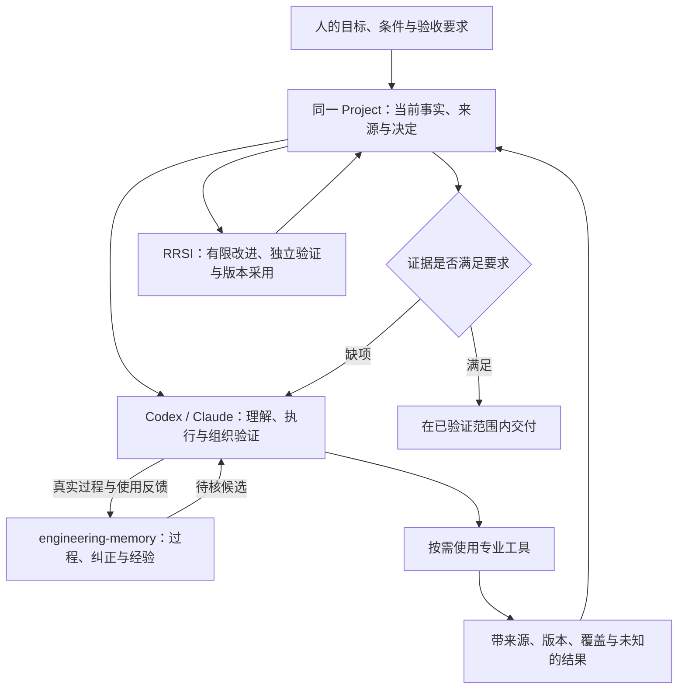

# OntologyEngineering

**工程本体 v2 × engineering-memory × 专业工具：让工程任务、证据、决定与经验形成闭环。**

用户用自然语言提出目标、条件和取舍。Codex、Claude 等 Agent 组织任务；工程本体在同一 Project 中维护对象、版本、来源、检查与决定；工程记忆保存过程、失败、纠正和可核查的经验。专业工具按需提供调查、计算或运行证据，结果回到同一项目审查。

当前为 **2.0.0-rc.6 整合候选，重构中**。实际验证见[验证记录](docs/UNIFIED-VERIFICATION.md)，具体工程能力与未完成项见[发布范围](docs/RELEASE-SCOPE.md)。



## 系统组成

| 部分 | 职责 | 安装方式 |
|---|---|---|
| 工程本体 v2 | Project、工程检查、语义执行、生成合同、版本与采用 | 本仓库统一构建 |
| engineering-memory | 原文来源、时间线、经验修订、召回、项目交接与反馈 | 随本仓库构建，入口 `oev2 memory` |
| GitContribute | 仓库、相关工作与贡献约束调查 | 用户安装上游版本及必要 diff |
| LeanToken | 本地源码定位与精确上下文回读 | 同上 |
| REA | 发布制品、二进制与限定运行行为调查 | 同上 |
| Jacobian | 精确计算、有限搜索与数学结构分析 | 同上 |
| SmokingGun | 静态复杂度候选与优化证据组织 | 同上 |
| flameox | 已有性能原件分析及授权工作负载测量 | 同上 |

任务按缺口选择工具，不要求每次全部调用。完整版本、上游安装入口、diff、companion 和验证方法见[专业工具安装与接入](docs/TOOL-INTEGRATIONS.md)。本仓库维护接入差异，上游实现由各项目提供。

核心工程与记忆流程不需要 Jev 或相关专用判断服务。任务解释、资料审阅和开放判断由当前 Agent 完成；Rust 检查明确的合同、来源与关系。模型答复、程序退出成功、经验召回和工程采用分别记录。

## 安装核心系统

准备 Git、[Rust/rustup](https://rustup.rs/) 和平台 C/C++ 编译工具。工具链由 `rust-toolchain.toml` 固定，依赖使用 `Cargo.lock`。首次构建需要下载依赖；已备齐时可加 `--offline`。

把仓库克隆到真实目录。也可选择当前 Agent 宿主支持的 Skill 搜索目录。

```sh
git clone https://github.com/jiaqiwang969/OntologyEngineering.git "$HOME/OntologyEngineering"
cd "$HOME/OntologyEngineering"
sh scripts/install.sh

export ONTOLOGY_ENGINEERING_ROOT="$HOME/OntologyEngineering"
export PATH="$ONTOLOGY_ENGINEERING_ROOT/var/install/bin:$PATH"
oev2 --root "$ONTOLOGY_ENGINEERING_ROOT" --version
oev2 --root "$ONTOLOGY_ENGINEERING_ROOT" memory capabilities
oev2 --root "$ONTOLOGY_ENGINEERING_ROOT" memory status
```

安装器构建本体与记忆的八个原生程序，在 `var/install/` 保存二进制摘要、构建配置和安装身份。默认 development profile、两个编译任务；优化构建使用 `sh scripts/install.sh --release`。安装器不安装外部专业工具、不启动常驻服务，也不替换旧全局 `oe`。

将本仓库 [SKILL.md](SKILL.md) 作为统一技能入口交给 Agent，按 [AGENTS.md](AGENTS.md) 配置项目、记忆及工具，新会话确认加载的是新入口。memory 默认使用本安装的 `var/memory/`；共享库通过 `oev2 memory --home /absolute/shared-memory …` 显式选择，不自动搜索其他 profile 的数据。

平台资格以实际验证为准。原生 CAD 另需对应平台、SDK 与真实验收；一次源码编译不能授予跨平台或工程资格。

## 从一个任务开始

例如向 Agent 提出：

> 检查这个仓库的重复查找是否值得优化。保持行为和输入条件，查相关实现、记录基线，把结论与依据放进同一项目，最后保存方法及失败经验。

Agent 按以下流程工作：

1. 建立或明确选择同一 Project，保存原要求、对象版本、条件和验收项。
2. 召回经验，核对原文、纠正与适用条件，交接为待核候选。
3. 选择工具，保存实际输入、工具身份和原始输出；性能任务先取得可比基线。
4. 经 `project tool-result verify/register` 回交，再经 `project decide` 更新决定；工程采用另走原采用合同。
5. 将过程与真实使用反馈交给 memory，在后续任务中重新核对适用性。

按[第一个完整 Project](docs/FIRST-PROJECT.md)可实际跑通记忆、数学工具、决定、反馈和下一会话召回。详见[专业能力交接](references/professional-capabilities.md)、[工程方法](SKILL.md)、[记忆模块](modules/engineering-memory/README.md)和[命令说明](docs/USAGE.md)。Agent 维护结构化记录，用户无需手填 TOML、YAML 或 RDF。

## 原始资料与私人数据

书籍和米思米目录单独放在 [Google Drive 原始资料包](https://drive.google.com/drive/folders/1QoNTu0gy9aPwQ-Sk6y5IWSBcVUCDVdXK)。`books/`、`misumi/` 和 `upload-manifest.json` 用于资料交付；来源登记、内容适用性与工程采用分别核查。资料按其权限和许可使用。

仓库不包含私人书籍、聊天 session、记忆库、客户项目、设备配置、凭据、历史工作区和编译缓存。`sources/` 保存用户合法取得的原件，`var/` 保存项目、记忆与运行记录。软件升级不自动更新 Drive；原件实际变化时才更新对应文件与清单。

## 开发与范围

`specs/` 是规范正本，锁定真实 ggen 生成 `generated/`，复杂算法由 Rust 实现。工程与 memory 共享 workspace、Cargo.lock 和语义实现。外部工具版本与 diff 位于 `integrations/`。

- [能力与工程边界](docs/CAPABILITIES.md)
- [当前版本及延期范围](docs/RELEASE-SCOPE.md)
- [新用户和开发 Agent 配置](AGENTS.md)
- [运行与生成方式](docs/USAGE.md)
- [验证记录](docs/UNIFIED-VERIFICATION.md)

v1 保留在仓库历史中。旧通过不授予本候选或新平台资格。

自有部分适用根 [LICENSE](LICENSE)。第三方与派生部分保留各自许可证及来源；memory 的 [NOTICE](modules/engineering-memory/NOTICE.md) 和所附许可证另行说明来源与条款，整个依赖集合不应被视为同一种许可。
