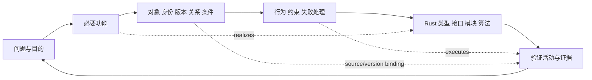

# 从自然语言工程问题到 Rust 的注释设计方法

agent 从当前目的、对象、条件、取舍和证据整理规范，用户不手填 TOML/YAML/RDF。先判断必要功能和失效后果，再选择计算、状态机、流水线或适配器结构；不用一张通用表代替所有算法。

## 先解释当前问题，再表达规范

先辨认当前研究的对象，以及涉及的表示或模型、求解方法或算法、具体实现、主张和证据。对象可以是实物、过程，也可以是待研究的模型或程序；它们在本任务中的作用需要结合目的说明。同一文件可能提供历史线索，也可能成为待检查的实现；同一工具可以用于探索、计算或校验。角色随问题变化，不能由工具名或文件格式固定。

围绕影响下一步判断的概念，说明它指什么、依赖哪些条件、准备支持什么结论。模型表达了对象的哪些方面，采用了哪些假设；算法准备解决模型中的什么问题，适用条件和误差要求是什么；实现承接算法的哪些行为，实际结果能够支持哪项主张。数学上存在解、取得可执行算法、程序忠实实现算法以及模型适用于实物，各有需要查明的关系。尚未成立的关系保留为假设或未知，并选择能补足依据的推导、探索、计算或测量。

据此确定当前可推进的局部工作及其对总目标的贡献（对象与根对象的关系、推进哪项根验收、参照案例何时返回，见[根目标锚定](goal-anchoring.md)），再把需要软件表达和处理的含义整理进规范。用户明确的先后依赖和验收要求随任务保留；已有局部依据足够时可以推进相应工作，未覆盖部分继续研究。这里提供解释方法，不要求每次行动填写固定表单；向用户说明关键依据、下一动作和范围即可。

## 在四环之间保持含义和依据

工程本体论指导辨认对象、活动、条件和支持关系；进入规范时，说明这些概念如何对应字段、类型、接口和依赖。ggen 根据受支持的规范生成合同及相关代码或说明，需要核对生成覆盖和含义承接。Rust 工程模块实现明确行为，按任务组织专业能力；实际运行及独立验证再检查实现、结果与原要求的对应关系。规范能表达、生成成功、程序执行完成及工程主张得到支持，分别按实际范围说明。

条件、对象版本或依据变化时，回看哪些模型前提、算法选择、实现和结论受到影响。RRSI 从真实反馈中判断需修正的是任务解释、规范表达、实现还是使用方式；已有表达足够时更新实例，提出方法改进时另行检验。四环围绕同一问题往返承接，所需活动由当前缺口决定；下面的图展开其中从工程问题到软件结构与验证的对应关系。

### 例：旧计算表在载荷变化中的作用

研究一个支架时，旧计算表可以帮助发现过去采用的载荷、支承假设和计算方法。此时它是历史来源，也可以是待检查对象。先将这些声明与当前支架的实际工况区分，查明模型为何适用、哪些参数仍是假设；旧表中的结果提供研究线索，其对当前主张的支持范围仍需核对。

当对应模型、求解方法和局部误差要求已有依据，可以据此整理计算合同并编写实现。生成物是否保留输入单位、边界条件和误差含义，代码是否实际执行所选算法，计算结果是否达到要求，以及支架在实际条件下是否合用，分别需要相应证据。同一程序在这个阶段承担实现职责；若后续用它比较其他实现，还需说明比较的独立性与覆盖。

若载荷或支承发生变化，先辨认变化影响的前提和下游结论。新的结果可能暴露输入整理、模型适用、算法或实现方面的问题，应按证据定位。若项目规定先落实数学依据再编写新实现，就保持这条依赖；事后取得的依据按实际时间登记。若当前需要探索来确定模型，则按探索目的取得新信息，再判断其能够支持的后续工作。



工程世界包括需求、对象、功能、条件、主张、证据、决定、变化和适用范围；软件世界包括模块、类型、接口、行为、副作用、错误、平台和验证。关系必须回答：哪个模块承担功能，哪个生产检查执行约束，哪个独立案例验证行为，来源或条件变化影响谁。

## 正本字段和填写要求

`specs/engineering.toml` 是可执行规范示范。所有填写均由 agent 维护，保留用户原意与来源，未确认项写 unknown/待验证及其条件，不编造值。

| 规范对象 / 字段 | 含义与填写要求 | 格式、Rust 映射及验收 |
|---|---|---|
| schema / version / problem / purpose | 规范格式、设计版本、真实问题、要产生的功能或结果 | 支持的 schema、非空；版本不等于对象修订或包版本 |
| requirement.id / function / condition / acceptance | 必要功能、成立条件、独立验收依据 | 稳定标识；禁止模糊“可用/完整”充当标准 |
| module.id / kind / rust_path / realizes | 所有者、结构种类、实际源码路径、承担哪些功能 | 安全相对路径；kind 为 calculation/state_machine/pipeline/adapter/contract/governance；引用存在 |
| module.platform / effects / failures / status | 平台和 ABI、读写副作用、错误/未知/重试、实际证据等级 | 明确未知写入是否允许重试；source_only 不等于实机验证 |
| depends_on / source_refs | 调用/数据/条件依赖及方法来源 | 引用稳定身份，供变化闭包；未声明依赖仍未知 |
| type.name / meaning / identity | Rust 类型、工程语义与身份规则 | 合法 Rust 名称；说明对象身份如何保持和建立新版本 |
| field.name / meaning / required / write | 字段概念、必填条件、agent 如何取得与写入 | 名称合法；Option 与 required 一致；不得以默认空串隐藏缺失 |
| field.rust_type / format / unit / precision | 数据形态、允许编码、量纲和精度 | String/bool/u64/i64/f64/JSON/已声明类型及 Vec/Option；单位或精度不适用须解释，不省略 |
| field.applicability / acceptance | 适用条件、约束及可独立验证依据 | 当前生成器只执行明确支持的格式检查；其他条件须连到手写生产检查 |
| constraint.id / requirement / module / check | 工程约束及真实执行检查 | 不能只写规则文本；检查和函数名存在仅为静态线索，需反例执行 |
| machine.module / states / initial / transitions | 所有者、有限状态、事件、前后状态与 guard | 同一状态/事件不可歧义；生成合法转换不自动证明 guard 或授权 |
| interface.module / method / input / output / error / effects | 责任边界、数据与错误、副作用 | 生成 trait，手写 Rust 实现；调用方、文档和行为测试需一起更新 |
| validation.id / behavior / constraint / rust_path / oracle / scope | 案例、检验哪条约束、实际测试位置、独立预期和证明边界 | 保留正例、单故障、未知及恢复案例；不能从输出倒推预期 |
| source.id / identity / role / applicability | 来源版本/摘要、支持何种方法及边界 | 分发中不包含原文、凭据或私有路径；精确原件定位在 sources/var |

所有模型标识必须唯一，包括派生实体；字段含义不一致时先核对工程概念，不能把同名自动当同义。值的类型、单位、精度、版本与适用条件也是合同的一部分。

可采用以下注释，说明必须体现在对应可解析字段，而非只写评论：

```toml
# @field value：当前对象在已声明条件下的量值。
# @required：取得量值才写；缺信息保留未知，不能用 0 补齐。
# @write：agent 从测量/计算来源提取，保留原单位和精度。
# @format finite：拒绝 NaN/Infinity；JSON 不能编码这些值。
# @unit：必须显式给出，不从数字猜测。
# @Rust f64：可表示范围和误差须满足实际问题；金额使用既有精确十进制。
# @acceptance：独立数值/量纲检查，原生测量与模型估计分别取证。
```

## 按模块性质选结构

| 模板 | 必需设计内容 | Rust 结构与验证 |
|---|---|---|
| 计算函数 | 输入来源、量纲、边界、公式/算法、精度、未知与溢出 | 纯函数 + 类型合同；独立手算、边界/单位错误、反例。复杂可靠算法复用原实现 |
| 状态机 | 身份、状态、事件、前后条件、guard、权限、不可逆效果 | 生成 enum/合法转换；手写 guard/权限/事务；禁止跳级、重复执行与伪造通过 |
| 任务流水线 | 目标、输入快照、阶段、交接产物、预算、失败/部分/恢复 | 手写编排 + 生成接口/共享错误；中断重跑不重做未知副作用，历史记录可追溯 |
| 外部工具适配器 | 原生工具身份、平台/ABI、输入输出、写入授权、回读 | 薄适配层；实际工具 smoke + 保存/重开/读回/摘要；mock 只验合同，不验 native 能力 |
| 治理与来源 | 包/对象/条件/authority 的独立身份、变更、历史 | 内容绑定、只读引用、连续事件、范围检查；验证不授予晋升或发布权限 |

## 生成与验证

规范 → Rust 校验/规范化 → 排序的 ground RDF → 锁定官方 ggen 查询/Tera → 共享 Rust 合同、检查、接口说明与清单 → 编译和实际行为。

编辑规范与派生 RDF 不是两份人工设计：RDF 由 Rust 产生，`generated/` 由真实 ggen 产生。归一化数组顺序不影响输出；输入错误在发布前拒绝；重新生成比较漂移。生成失败保留旧工作版本。设计或来源变化后分析依赖，更新检查和案例，保留旧回执作为历史。

新增功能也走同一链：补必要功能/对象/条件，选择模块结构，声明共享接口与错误，复用或实现 Rust，连接约束与独立案例，真实生成并验证。项目尚未完成全细分合同覆盖，检查线索与行为证明分别记录。
