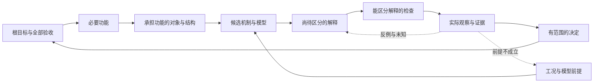

# 用同一组工程关系组织判断、行动和接续

本体首先回答：为了谁的什么目标，哪个对象在什么条件下需要表现出什么行为；哪种结构或机制可能承担该功能；凭什么相信它；缺少什么观察才能决定。任务由这些关系中尚未成立的部分产生。目录、专业名称和工具能力只帮助安排实施，不能替代这个依据。

具体工程关系来自当前 Project、work、模型和原件。Agent 负责解释与补齐它们，软件核已表达关系、来源和可执行条件。关系可能需要修订；不能为了排出任务清单而补造机制、量值或物理因果。

## 从工程关系产生当前工作

按当前问题往返查这些联系，无需把每项任务硬套成同一条直线：

这张图是工作方法，箭头是否在具体工程中成立要逐项说明。把“某机制可能实现功能”与“该结构已在当前条件下实现功能”分开；相关来源、模型预测、工具回读和实物观察也各有支持范围。同一个产物在不同活动中可以承担不同角色。

选择下一步时说明三个实际问题：这一步推进哪项原验收；它检验哪个解释及其前提；不同观察会如何改变候选或决定。只有先区分这几件事，才知道该查资料、补模型、改结构、算参数还是做实物检查。未安排验证的验收项继续保留，不能因当前路线没有覆盖就消失。

例如夹具定位反复不准，先回到“在指定载荷和工序中保持定位精度”。候选原因可能是间隙、弹性变形或装配基准变化；查清各自前提，再选择能区分这些原因的观察。若只知道某次误差变小，仍不足以确认原因。若载荷前提改变，沿已有依赖重审刚度判断和依赖它的工序选择，而不是默认所有旧结论继续成立。

## 当前程序表达了什么

`project explore reasoning` 从已冻结的探索和同一 Project 派生 `oev2.engineering-reasoning-view/2`。它复用已有 work、engineering basis、假设、动作、分支及原生结果回读，不要求另建一份关系正本。合同在 `specs/modules/knowledge-query-planning.toml`，由真实 ggen 生成，Rust 负责投影和复核；命令见[探索接续](../docs/ENGINEERING-EXPLORATION.md)。

| 关系或结果 | 原件与实际含义 |
|---|---|
| 目标、完整验收、对象、功能、机制与缺口 | 当前 Project 与冻结 work；上下文关联不自动证明物理实现关系 |
| 动作推进验收、调查缺口、区分假设 | 冻结计划中的明确引用，不按相同措辞猜测两个概念相同 |
| 动作需要前提、等待某结果 | 原 engineering basis 的事实状态及冻结 `required_facts` / `when_outcomes`；未知事实原样保留 |
| 已有工程主张和检查 | `assertions` 按原条件内的位置单独呈现，`checks` 重用 `engineering::checks_current`，保留执行、结论、失败和原 owner 的支持范围；关联同条件动作、受影响决定及明确相同的验收 |
| 结果支持、否定或要求复核解释与路线 | 冻结结果分支；只有原 owner 回读且唯一匹配的结果才建立分支，原因假设仍按原规则保持未知 |
| 某检查可能影响哪些决定 | 把被检验决定以明确类别交给原 Project 影响 owner，沿已声明依赖列出复核范围；这不是物理因果证明或自动修改决定 |
| 本次路线没覆盖什么 | `complete_acceptance` 始终保留完整原验收；`uncovered_acceptance` 只表示尚无探索动作直接声明推进的项目，不等于已失败或无需完成 |

节点的 `value` 可按 `source` 摘要和 JSON `pointer` 回到原文；条件字符串内的事实和主张另有 `embedded_pointer`。行动、观察和路线依据保留在 `sources` 中；工程检查另由原 owner 重读其专用原件，完整结果在 `checks`，不将检查输出冒充原文。边说明关系种类、端点及原声明位置。视图验证重新读取绑定原件、重跑当前检查并派生完整结果；修改检查结论或派生关系会被拒绝。旧 `/1` 视图只保留历史身份，当前使用重新派生 `/2`，不改写原冻结输入或历史结果。

这里的节点是当前活动中的角色，不是对所有工程对象作新的全局分类。程序不会从文字自动建立功能与结构的真实实现关系，也不会发现全部遗漏依赖；这些仍由当前工程研究给出。现有 Semantica、领域规则、Project 和原生工具继续承担各自语义与检查职责。

## 身份、功能实现与主张成立条件

对象、资料、条件、决定的类别是身份的一部分。同名不能自动建立关系。当前 `project reconcile` 用带类别端点比较前后版本；`project impact --typed-changes <JSON路径>` 接收 `[{"kind":"evidence","id":"资料原ID"}]`，类别也可为 `object`、`condition`、`decision`、`source_digest`、`dependency` 或 `purpose`（后者 ID 固定 `project:purpose`）。`affected_entities` 保留类别，`decisions` 才是决定复核范围；`affected` 是兼容展示名，不能据此判断决定是否受影响。

旧 `dependencies` 和 `--changed` 是无类型名称。可唯一识别时显式适配；多义名称在 `legacy_ambiguities` 中列出，并保守保留可能路径。Agent 应核原关系的含义，不能把多义结果当成已确定的工程依赖，也不能靠改对象名称掩盖问题。新绑定的功能与组合主张会把所引用对象、条件及来源接入同一影响计算，仍需调查未声明的依赖。

`function_continuity` 的当前要求可用生成的 `EngineeringFunctionRealization`，`requirements.schema` 为 `oev2.function-realization/1`：

- `function_id`、`inventory_scope` 保留功能和清单范围；`state` 区分 `assigned`、`candidate`、`unresolved`。
- `realization` 引用同一 Project 的完整 `ObjectIdentity`。`mechanism_assertion` 指向该对象条件中的机制或模型边界检查；`verification_assertions` 指向实际数值、机制行为或 CAD 检查。
- 已分配的实现必须绑定当前对象、版本、条件和来源，并由原 owner 重验所引用检查。候选、引用缺失、旧版本、未通过的检查不能成为已成立的实现依据。旧自由文字声明重新检查时标为 `legacy_text_only / unknown`；完整清单中的缺失实现仍为 `violated`。

这里的通过只支持已声明功能分配及其限定检查，不自动证明机制解释充分或实物已实现功能。来源文字、模型结果和实测依据继续保留原角色。

`claim_composition` 使用 `oev2.claim-composition/1`，把一个决定绑定到当前对象和该工程 basis 中一项精确 `criterion`。`all_of` 每项都须通过；`any_of` 的每组至少一项通过；`interfaces` 单独列出接口或合成量检查。引用均为 `{object: ObjectIdentity, assertion_id: ...}`，由已有数值、机制行为或 CAD owner 执行。`scope=system` 要求接口检查；`coverage=partial` 保留未完成分解。重复引用、无依据的自循环和仅靠另一个关系声明来证明关系，都不能提供通过。

例如两处定位部件分别满足自己的偏差要求，整机还需验证装配对中；接口结果缺失则整机声明为未知，超限则为违反。替代方案有一项通过可满足该组，但其他必要项仍须满足。当前支持一层显式组合；拆分是否充分、工况如何跨部件换算、未建模的耦合和时序仍由工程研究给出，不能由 `declared_complete` 一句话认证物理完备。

针对已绑定主张的 `project decide`，`claim_scope` 必须等于原 `criterion`；支持/反驳方向必须与当前组合检查相符，同时继续要求已登记工具原件。没有绑定的历史决定保留调用者评审范围，回执明确不曾验证命题蕴含。Agent 为新建且需要软件判断的组合主张建立该绑定；无法形式化的部分保留明确的工程评审。采用仍由原审查和批准流程决定。

## 下一步依据和执行使用同一原件

`recommended_action` 优先返回当前等待回读的动作，否则按冻结顺序返回首个满足已表达分支和预算条件的动作。它解释现有计划，不另作效率排名。

| 动作状态 | 接下来做什么 |
|---|---|
| `ready` | 检查列出的未决前提和已有授权，执行当前有范围的调查；就绪不证明模型适用 |
| `awaiting_host` | 取得或回读已经提出的当前动作结果，保持原对象和判据 |
| `blocked_by_outcome` | 补足列出的前置结果；失败、部分结果或未知不能代替它 |
| `blocked_by_pending_result` | 先处理当前待回读动作，再沿冻结顺序继续 |
| `recorded` | 保留限定来源/模型范围的结果及剩余工程义务 |
| `needs_review` | 查原观察、前提和比较；取得新依据或修订探索后再尝试 |
| `budget_exhausted` | 保留未完成义务，准备新的有界探索 |

未决前提可以成为调查对象，所以 `ready` 与 `unresolved_premises` 可以同时出现。它不授予计算适用性、工具写入或工程采用。当前 Agent 在已有授权内推进，`automatic_dispatch` 保持 false。

`engineering_obligations` 引用动作所用候选条件的检查节点，结合 `checks` 读取尚未满足的工程约束。`requires_review_before_adoption` 不阻止调查；“共享同一条件”也不表示动作已经验证了该条件。计算是否能执行仍由原计算/模型 owner 判断。

`advance` 输出附带同一派生视图；workspace 接收探索结果并 `resume` 时，从原 owner 再次派生同一内容。因此恢复不仅知道“做过什么”，还知道“依据什么做、哪个解释未成立、后面哪些决定需要复核”。缺少或改变原件时按原合同拒绝或报告缺项，不能让旧摘要替代当前复核。

## 让反馈回到关系的缺口

结果不符先沿“观察 → 被检验解释 → 所依赖前提 → 受影响决定”定位，再判断应修改什么：

- 原关系表达足够，量值、对象修订或记录有误：修当前实例并重验相关决定。
- 原关系正确，程序选错分支或恢复丢失依据：修规范/实现及对应反例。
- 多个实例都无法表达必要关系，或方法持续选择无区分力的检查：提出共享表示或方法候选，补全四环的含义、合同、行为与独立案例。

每项反馈引用原动作、前提、结果和影响范围；memory 保存带条件的经验候选，RRSI 按[有证据的改进](regularized-evolution.md)另作固定目标和判据下的比较。视图一致、软件测试通过和一次项目成功分别报告；它们不自动证明方法更快、更省或可泛化。
